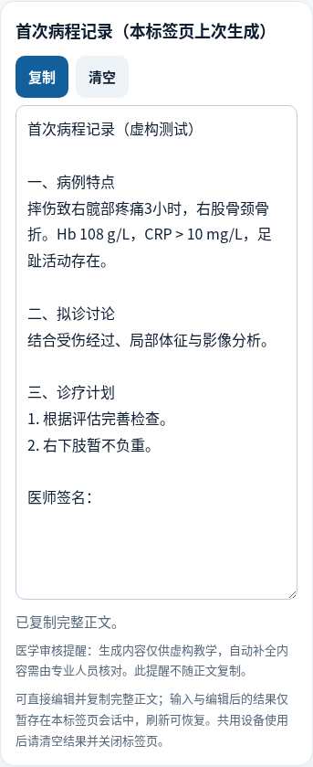
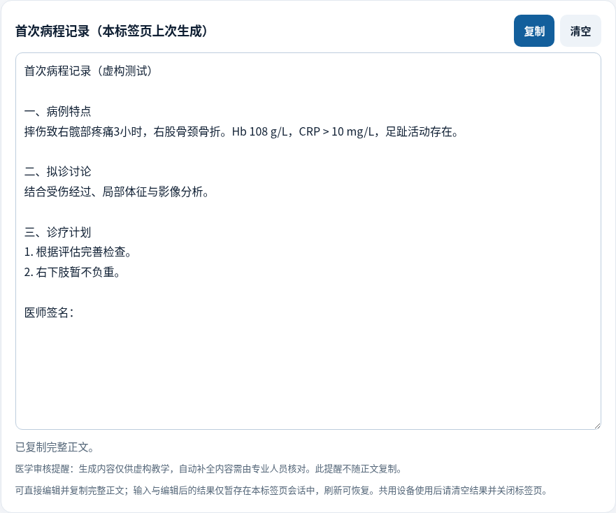

# AI 病历生成优化：实现与验收记录

- 执行：Codex；类型：代码（含医学写作提示词）、回归测试与验收工具。
- 基线：最新 `main` 的 `03cdea7`，分支 `fix/ai-record-quality-20261116`。
- 范围：`/note` 与现有 `/api/note-generate`；没有修改医学模板源数据、身份账本、API 提供方、模型配置、限流基础实现或发布配置。
- 医学状态：提示词和模型输出仍需负责人医学审核。本次技术测试不等于医学认证。
- 按负责人在本任务中的答复，未配置非生产 DeepSeek 密钥时先交付代码及可运行验收脚本；20 份真实模型输出尚未验收。

## 实现

| 文件 | 修改目的 |
| --- | --- |
| `api/note-generate.js` | 保留补全模式和原有篇幅要求，分别完善八类文书的结构、查房顺序、事实优先级及检查到处理的逻辑；参考章节选择对应结构；医学审核提醒移出正文。保留表格单元格、医学比较符号、负号、乘号、指数、单位和编号，清除明确排版及旧版固定提醒。拒收截断、非正常结束、空正文及未闭合思考标签。 |
| `note.js` | 保存用户编辑后的正文，按稳定 ID 恢复参考病例与章节；输入变化标记旧结果；暂存失败可见提示；65 秒客户端超时；失败保留旧正文；生成期间锁定输入与清空操作，避免请求与结果错配。复制附近反馈及手动全选回退。 |
| `note.html`、`note.css` | 独立医学审核提醒、明确补全模式的输入提示、暂存说明、移动端结果标题与按钮换行。 |
| `test/note-generate.test.js`、`test/note-clinical.test.js` | 参数与安全边界、正文转换不丢信息、超时及失败路径、五病种二十场景的事实传递和文书结构契约。 |
| `e2e/site.test.cjs` | 手机和电脑上的编辑恢复、参考选择恢复、真实剪贴板粘贴、错误/超时保留旧文、存储禁用与复制失败回退。 |
| `scripts/fixtures/note-cases.mjs`、`scripts/evaluate-note-generation.mjs` | 仅使用内置合成资料，准备或实际生成二十份文书，输出逐份正文、输入、信号检查及人工审阅表。 |

没有增加必填字段；主诉、诊断、需要手术的文书的术式、每日病程的天数要求与原版一致。常规病程、常规体征、术前准备、手术步骤、术后处理与康复的补全范围保留。只有文书必需但未提供的个体参数采用原有 `【按实际填写】`；禁止用大量空白字段代替正文。

复制正文仍来自可编辑 textarea 的完整值，没有拼接页面标题、审核提示或说明。清理仅处理可识别的格式，保留如 `> 正常上限3倍` 等存在医学含义的符号，不使用按“说明”“注意”等词删除整段内容的规则。提示词约束不是模型输出的确定性保证，仍需真实接口及人工逐份验收。

## 参数与安全核对

- 原接口：默认 `https://api.deepseek.com/chat/completions`，默认 `deepseek-chat`；保留 `NOTE_AI_BASE_URL`、`NOTE_AI_MODEL` 的服务端覆盖方式。
- 原请求参数不变：`temperature: 0.5`、`max_tokens: 3500`、`stream: false`。不增加自动重试、自动续写或额外调用，避免重复计费及语义重复。
- 保留服务端请求 55 秒超时与 Vercel 60 秒执行上限；客户端 65 秒后停止等待并保留原文。原 Blob 限流耗时及其基础实现留待独立整改。
- 根据 [DeepSeek 官方接口说明](https://api-docs.deepseek.com/api/create-chat-completion)，只有 `finish_reason: stop` 视作完整结束；`length`、`content_filter`、`tool_calls`、`insufficient_system_resource`、`aborted` 以及缺失结束状态不作为成功正文返回。只取 `message.content`，不公开 `reasoning_content`。
- 官方当前文档示例使用更新型号，本次按任务要求保留仓库原模型与配置；未在无测试密钥时推断现有账号的型号可用性。
- 保留管理员会话、同源/Fetch Metadata、管理请求头、JSON 与 16 KiB 请求限制、身份信息识别、`Cache-Control: no-store`。密钥只在服务端使用；客户端仍只访问同源接口。
- 浏览器仍只用 `sessionStorage` 暂存，无新增持久存储、服务端正文存储或内容日志。没有读取生产凭据、登录生产后台或访问生产私有数据。
- 现有限流的并发计数及 fail-open 风险列于 [独立整改建议](note-rate-limit-followup.md)，本 PR 不替换限流实现。

## 技术验证

环境：Node 22.23.5，仓库锁定依赖，系统 Chromium，Playwright 1.61.1。默认 npm 缓存不可写，改用 `/tmp/hajimi-npm-cache` 后 `npm ci --ignore-scripts --no-audit --no-fund` 成功；未改依赖文件。

| 检查 | 结果 |
| --- | --- |
| `npm test` | 310 项通过；最终正文符号修正后另跑相关 24 项专项测试通过 |
| `npm run build` | 通过 |
| `npm run audit:quality:check` | 0 阻断、0 人工复核项、2 条既有示例检验值提醒 |
| `npm run audit:clinical` | 通过，正文哈希不匹配 0；不包含生产 CMS 审计 |
| AI 页面 Playwright 专项 | 5 项通过；390/1280 px 无横向溢出；真正写入剪贴板并粘贴到独立 textarea，逐字比较包括换行与符号 |
| `npm run test:browser` | 全站 83 项通过，含手机/电脑布局、搜索、病历预览/复制/打印、临床工具及管理页面；截图捕获调整后单独复跑对应检查通过 |
| 验收脚本准备模式 | 成功输出 20 份请求与待审清单，明确标记“未调用模型” |
| 无密钥执行 `--live` | 按预期拒绝，未发出模型调用 |

新增浏览器测试第一次选择了无静态正文的“通用场景”，修正测试为从目录寻找实际有正文的章节后通过；未通过改动产品数据来规避失败。

截图使用合成的排版测试正文，**不是 DeepSeek 的实测输出**：

| 手机 390 px | 电脑 1280 px |
| --- | --- |
|  |  |

## 二十份病历实测方法

在非生产环境使用 Node 22，安全配置现有 `NOTE_AI_API_KEY`；如已有非默认配置，同时设置 `NOTE_AI_BASE_URL`、`NOTE_AI_MODEL`。不要把密钥写进命令历史、报告或仓库。当前云环境的网络允许列表还需由环境负责人开放实际测试 API 主机；本次未更改网络策略。

```sh
# 不调用模型，准备五类病例 × 四类文书的输入、提示词及待审清单
node scripts/evaluate-note-generation.mjs --out /tmp/hajimi-note-prepare

# 配置好非生产密钥及网络后，调用原有 handler 与原有 DeepSeek 请求参数
node scripts/evaluate-note-generation.mjs --live --out /tmp/hajimi-note-live
```

每次使用新目录；输出置于仓库外，防止误发布。脚本只使用五类内置合成病例，依次生成首次病程、术前小结、手术记录、术后第 2 天病程。鉴权使用本进程随机合成会话，限流使用注入的本地测试替身，不登录部署、不写 Blob，也不为失败调用自动重试。

逐份对照 `scenarios.json`、`*.request.json`、`*.txt`、`report.json`、`REVIEW.md` 检查：完整性、自动补全、医学逻辑、格式、占位符、复制、输入事实。脚本提供字符数、占位符、关键原文缺失和已知冲突词线索，不能判断全部医学矛盾或证明质量通过；缺失精确字符串也可能只是合理改写，必须读全文核实。测试明确覆盖禁负重、过敏、未输血、未放置引流、未植骨、未行髌骨置换及未行腕管松解等约束。

剩余验收：运行二十份 DeepSeek 实测、负责人医学审核、GPT-6 独立技术审核、GitHub CI 与 PR 预览核对。不得自行合并或发布生产。
