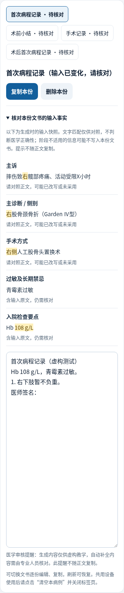
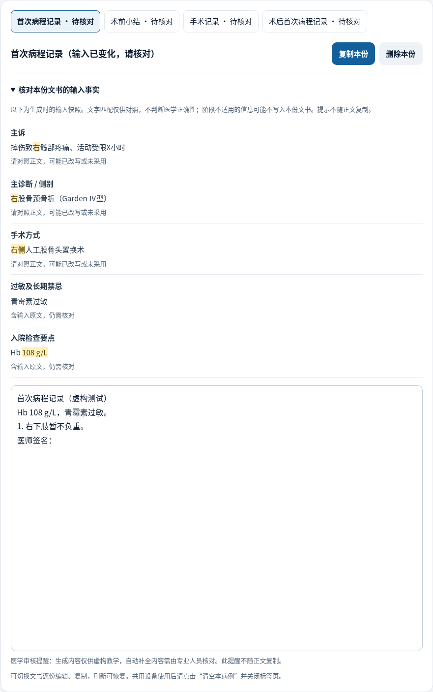

# AI 病历整套生成与病例信息复用

日期：2026-11-16（北京时间）。执行：Codex；独立技术审核：GPT-6。基于最新 main `9921918`，分支 `feat/note-workflow-20261116`。这是 PR #122 上线后的新增功能，未沿用上一次发布授权。

## 使用方式

1. 填写一次主诉、诊断及所需术式。过敏、入院检查和已确认的手术细节可选填，不新增必填项。继续按原有补全模式生成完整段落。
2. 勾选本次文书，点击“生成所选文书”。默认首次病程、术前小结、手术记录、术后首次病程；也保留原有八种单份生成入口。
3. 文书逐份调用原 `/api/note-generate` 并保存。失败会暂停，刷新不会自动发送请求；点击“继续未完成文书”才继续。点击“完成本份后停止”会保存正在生成的这一份后停止。
4. 在结果区切换文书，分别编辑、复制。仅重新生成同类型、同一天的文书时确认替换；删除本份不删除其他文书。生成正文不会回填为病例事实。
5. 每日病程选择术前/术后阶段并填写对应天数；“下一天”保留基础病情、清空当日变化。切换阶段会清空天数和变化。两种阶段的天数不能共用一次批次。
6. 展开“核对本份文书的输入事实”，对照生成时的主诉、性别年龄、诊断侧别、术式、过敏、检查和实际手术细节。数字及侧别高亮，文字匹配仅供人工核对，不是医学正确性判定。快照、提示和审核提醒不进入复制正文。
7. 更换病例时使用“新建病例 / 清空本病例”。切换参考病例或常见病种也会确认清空当前病情和文书，防止混用。

## 结构与数据边界

| 文件 | 用途 |
| --- | --- |
| `note.js` | 固定输入快照的串行生成、失败续做、停止、跨日/跨阶段确认、病例清空、草稿保存。 |
| `note-documents.js` | 本标签页的多份文书、独立编辑、输入快照展示、旧版单份结果恢复。 |
| `note-workflow.js` | 类型与天数对应的文书身份、标题、输入事实列表、文字对照。 |
| `note.html`、`note.css` | 可选核对要点、整套生成、文书切换和响应式布局。 |
| `api/note-generate.js` | 可选字段的限制与隐私检查、实际手术细节的阶段范围、参考章节分类。 |
| `scripts/public-assets.mjs` | 发布两个新增页面脚本；由原构建流程生成内容哈希版本号。 |
| `test/note-workflow.test.js`、`test/note-clinical.test.js`、`e2e/site.test.cjs` | 阶段事实、参数保持、参考章节、队列保护、刷新恢复、复制与布局验证。 |

只使用 `sessionStorage`，不新增服务端病历存储或日志。每份文书按原有额度计数，不并发调用、不自动重试、不绕过限流。已有 65 秒客户端等待期限、55 秒服务端请求期限与截断拒收保留。生成中锁定编辑，失败保留既有正文。

保留 DeepSeek 默认提供方、`deepseek-chat`、原环境覆盖、`temperature: 0.5`、`max_tokens: 3500`、非流式协议、自动补全范围与已有必填规则。新增字段均可选；接口兼容旧请求。原身份验证、同源保护、身份信息识别、16 KiB 请求限制及服务端密钥使用不变；限流基础实现不变。未修改医学模板源数据、身份账本、安全配置、发布配置或依赖。

## 阶段处理与兼容限制

- 入院/首次病程、手术记录和出院章节不附带每日变化或每日天数；参考每日章节才使用对应阶段数据。明确术前/术后章节的身份不随下拉框错误阶段改变。
- “已确认的手术细节”和标为“仅手术及术后”的补充说明不进入入院、术前提示词。目录中的清创术及穿刺置管引流记录也识别为操作文书；术前讨论、知情同意、再手术决策不当作已实施操作。
- 旧版 `extra` 可能同时包含过敏与术中事实，无法无损地自动拆分。因此保留原文、标记未分类并要求按时间归属核对，用户可调整范围或移至实际手术信息。**该兼容路径仍依赖模型遵循时点指令和人工审核，不能宣称已消除所有临床时间错误。**
- 新任务、切日或切阶段会影响待续队列时须确认；取消保持队列。续做要求当前输入与原快照一致，已修改病情时应重新选择要生成的文书。
- 未失焦的天数编辑不持久化为新天数；完成切换确认后才更新，避免“新天数 + 前一天变化”在刷新后拼接恢复。
- 旧版单份结果可恢复；迁移后删除不会再次复活。暂存失败仍显示原有可见提醒。

## 验证

测试使用虚构输入、合成响应和本机静态构建服务，没有登录生产后台、调用生产模型或写入生产存储。

- Node 22，仓库锁定依赖，Playwright 1.61.1 与系统 Chromium。
- `npm test`：317 项通过。
- `npm run build`：通过。
- `npm run audit:quality:check`：0 阻断、0 人工复核项、2 条既有示例检验值提醒。
- `npm run audit:clinical`：通过；医学正文与身份账本保持不变，不包含生产 CMS 审计。
- `npm run test:browser`：全站 88 项通过。随后合并确认提示并修复未失焦的跨日草稿保存；最终重建、相关单测 31 项、页面浏览器专项 10 项全部通过。
- 浏览器验证 320 / 390 / 768 / 1024 / 1280 / 1440 px 无横向溢出；真实剪贴板复制并粘贴到独立文本编辑框，逐字保留正文与换行。
- `node scripts/evaluate-note-generation.mjs --out /tmp/hajimi-note-workflow-prepare-20261116`：准备 20 个虚构场景成功，明确标记未调用模型。

调试记录：一处浏览器测试用模糊文本同时匹配首次病程和术后首次病程，改为精确匹配；首次全站命令未指定本机 Chromium 路径而启动失败，后续显式设置 `CHROMIUM_EXECUTABLE_PATH=/usr/bin/chromium`。未通过删除产品断言或改变医学源数据来绕过检查。

独立技术审核发现的跨阶段传递、文书身份、队列覆盖、部分输入丢失及未失焦跨日恢复问题均已修复并补回归；当前复核未发现剩余可确认的新增阻断问题。技术审核不代替医学审核。

截图使用合成响应，**不是 DeepSeek 实测输出**：

| 手机 390 px | 电脑 1280 px |
| --- | --- |
|  |  |

## 剩余验收

负责人已说明暂未配置非生产密钥，先交付代码和可运行脚本。本次仍未执行 20 份真实 DeepSeek 输出验收，也未证明真实模型的完整性、事实一致性或医学正确性。配置非生产密钥后按 `docs/note-generation-acceptance-20261116.md` 使用 `scripts/evaluate-note-generation.mjs --live` 并逐份人工审核。

本 PR 提交审核，未合并、未发布生产。新增医疗写作提示词及真实模型输出仍需负责人医学审核；预览部署与 GitHub CI 以 PR 最新检查为准。
